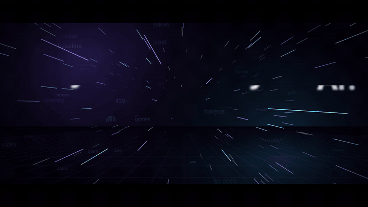

# LLM Reliability

Two tools for running LLMs in production, and one console for both:

- **Bifrost Replay Lab**: captures real gateway traffic, replays it against cheaper models under a budget cap, and returns a switch verdict (`SAFE_TO_SWITCH`, `SWITCH_WITH_CAUTION`, `DO_NOT_SWITCH`) with projected savings.
- **Stale-Answer Detector**: checks the claims in an LLM answer against the live web with Tavily, and returns a scored report and a corrected answer.

## Watch the demo (1:28)

<p align="center">
  <a href="docs/demo/llm-reliability-demo.mp4">
    
  </a>
  <br>
  <b><a href="docs/demo/llm-reliability-demo.mp4">▶ Play the full narrated demo</a></b> · recorded on the <a href="https://llm-reliability-console.vercel.app">live console</a>
</p>

The demo walks through both tools end to end: Replay Lab replays real Gemini traffic against two cheaper models and returns a verdict with monthly savings; the Stale-Answer Detector flags "Python 3.9 is the latest release" as stale, shows the evidence and score, and writes a corrected answer with its source.

| Folder | What's there | Owner |
| :--- | :--- | :--- |
| [`frontend/`](frontend/) | The LLM Reliability Console (React, Vite, TypeScript) | Design: anyone; wiring (`frontend/src/api/`): backend owner |
| [`backend/replaylab/`](backend/replaylab/) | Replay Lab: Go plugin for the Bifrost gateway, sidecar, API | Backend |
| [`backend/stale/`](backend/stale/) | Stale-Answer Detector API (Python, FastAPI) | Backend |
| [`backend/database/`](backend/database/) | Insights: a PostgreSQL 17 read copy of both services, its sync worker, and the read API behind console search | Backend |

**Before you change anything, read [CONTRIBUTING.md](CONTRIBUTING.md).** It says what you can change freely, what needs care, and how changes reach the live site.

## Live

| Piece | URL | Host |
| :--- | :--- | :--- |
| Console | https://llm-reliability-console.vercel.app | Vercel (root directory `frontend`) |
| Replay Lab gateway | https://replaylab-gateway.onrender.com | Render (`render.yaml`) |
| Stale Detector API | https://stale-detector-api.onrender.com | Render (`render.yaml`) |
| Insights API | https://insights-api-fjt3.onrender.com/api/health | Render, with a free Postgres 17 (`render.yaml`) |

Render's free tier sleeps when idle: the first request after a while takes about a minute, and the console shows "Starting the engine" meanwhile. The two services' free-tier storage is wiped on every redeploy; the Insights database keeps what it already copied and syncs new data every 20 minutes (and at once when it wakes).

## How a change goes live

1. Push a branch and open a pull request into `main`.
2. CI runs (`.github/workflows/ci.yml`): secret scan, Replay Lab tests, Stale tests, Insights tests against a real Postgres, console lint/tests/build, and a **contract check** that runs the real backends and confirms the console still reads every response.
3. `main` only accepts a pull request when CI passes. Changes to the console's API layer automatically ask the backend owner to review (`.github/CODEOWNERS`).
4. After merging, once CI has passed on that commit: GitHub Actions deploys the console to Vercel if `frontend/` changed (`.github/workflows/deploy-console.yml`), and Render redeploys only the backend service whose folder changed. A failed build never replaces the live version.

## Run it locally

```bash
# Replay Lab (no keys needed: a mock provider stands in for the LLMs)
cd backend/replaylab
go run ./cmd/mockprovider                                         # :8081
go run ./cmd/replaylab -port=8086 -gateway=http://localhost:8081  # :8086
go run ./demo/generate_traffic -proxy http://localhost:8086 -n 30 # some traffic to look at

# Stale Detector
cd backend/stale
cp .env.example .env            # add TAVILY_API_KEY (and LLM_API_KEY for LLM verification)
pip install -r requirements.txt
uvicorn app.main:app --port 8001

# Insights (Postgres 17 + sync + read API on :8090; needs Docker)
cd backend/database
REPLAYLAB_URL=http://host.docker.internal:8086 STALE_URL=http://host.docker.internal:8001 docker compose up --build

# Console
cd frontend
cp .env.example .env.local
npm ci
npm run dev                     # http://localhost:3000
```
