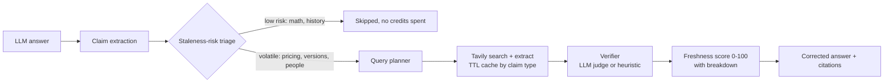

# Stale-Answer Detector

> LLMs state outdated facts with full confidence: old prices, superseded versions, former CEOs.
> Stale-Answer Detector takes any LLM answer, finds the claims likely to have gone stale, checks them against the live web with Tavily, and returns a scored report plus a corrected answer with citations.

Built for the Tavily track.

**🌐 Built-in dashboard:** the API serves a single-file audit dashboard at **http://localhost:8000/** — animated pipeline, freshness gauge, score breakdown bars, corrected answer with citations, one-click demo answers (from `GET /v1/samples`), and JSON report export. The full React operator console lives in [`../frontend`](../frontend).

## Pipeline



1. **Extract** atomic claims with character spans (LLM, or a regex extractor when no LLM is configured).
2. **Triage.** Each claim gets a staleness risk from its type (pricing 0.88, versions 0.82, ... timeless 0.05), adjusted for words like "currently" or "latest", referenced years, and `answer_date`. Low-risk claims are skipped and never cost a search.
3. **Search** with parameters chosen per claim type (see table below), then read the vendor's own page with `/extract`.
4. **Verify.** With an LLM key, an LLM judge compares the claim to the evidence. Evidence is fenced as untrusted, and the judge is told today's date. Without one, generic heuristics compare version numbers, prices and leadership names, and the verifier answers `UNVERIFIABLE` rather than guess.
5. **Score** each claim: `verdict_multiplier × (0.35·agreement + 0.30·authority + 0.20·recency + 0.15·relevance)`. Every component is returned in `score_breakdown`.
6. **Correct** the answer: stale claims are rewritten with the current value and a numbered citation.

### How Tavily is used

| Claim type | Tavily parameters | Why |
| :--- | :--- | :--- |
| Pricing, versions | `search_depth=advanced`, `include_domains` = vendor's official domains, then `/extract` on the top official URL | Ground truth is on the vendor's pricing or release page. Extract reads the actual table, not a snippet. |
| Leadership, events | `topic=news`, `time_range=year` (events: `month`), no domain restriction | Leadership changes are reported by the press, not on the company site. |
| Everything else | General search, with a broader fallback query if fewer than 2 results come back | |
| All | Results cached in SQLite with a TTL per claim type (leadership and news 30 min, pricing 6 h, versions 12 h, regulations 24 h) | Repeated checks reuse results instead of spending credits. |

Callers can steer search with `options.domains_allow` / `options.domains_block`, and bypass the cache with `options.force_fresh`.

## Setup

Requires Python 3.11+.

```bash
pip install -r requirements.txt
cp .env.example .env    # then set TAVILY_API_KEY
```

| Variable | Required | Purpose |
| :--- | :--- | :--- |
| `TAVILY_API_KEY` | yes | Live search. Without it every checked claim is `UNVERIFIABLE`. |
| `LLM_API_KEY`, `LLM_BASE_URL`, `LLM_MODEL` | recommended | Any OpenAI-compatible endpoint. Enables LLM extraction, judging and rewriting. |
| `API_KEY` | no | If set, every `/v1` request must send `X-API-Key`. |
| `DATABASE_PATH`, `CACHE_ENABLED` | no | Report history and search cache. |

**Verification mode matters.** Every report includes `verification_mode` (`llm` or `heuristic`). Heuristic mode is a safety net, not the product: it catches version bumps, missing prices and departed executives, and abstains on everything else. Run with an LLM key for the demo.

## Run

```bash
uvicorn app.main:app --reload --port 8000   # Swagger UI at http://localhost:8000/docs
python demo/run_demo.py                     # six realistic stale answers, rich terminal report
python benchmark/run_benchmark.py           # 30 labeled claims: precision, recall, abstentions
```

The demo and benchmark make live Tavily calls; the benchmark prints how many it used.

## Benchmark results

Measured live on `benchmark/labeled_claims.json` (30 balanced claims, 15 stale / 15 current), **heuristic mode** (no LLM key configured — the always-works fallback path):

| Metric | Value |
| :--- | :--- |
| Precision (staleness) | **75.0%** |
| Recall | 40.0% |
| F1 | 52.2% |
| Accuracy | 63.3% |
| Abstentions (`UNVERIFIABLE`) | 3 |
| Tavily credits spent | 28 |

Two things matter more than the raw numbers: the heuristic verifier **never guessed** — every miss was an abstention or a conservative `CURRENT`, never an invented verdict — and the whole run cost **28 credits** thanks to triage + caching. Heuristic mode is the safety net; with `LLM_API_KEY` set, extraction, judging and correction all run through the LLM and catch the subtler staleness cases (leadership euphemisms, superseded statuses, deprecated flags) that regexes can't.

## API

Full request and response shapes are in [docs/API.md](docs/API.md) and at `/docs`.

| Method | Path | Purpose |
| :--- | :--- | :--- |
| `POST` | `/v1/check` | Audit an answer; returns the full report |
| `POST` | `/v1/check/stream` | Same, as Server-Sent Events, one event per stage |
| `POST` | `/v1/wrap` | `/v1/check` taking `question` + `model_answer` |
| `POST` | `/v1/ask` | Generate an answer with the configured LLM, then audit it (`503` without an LLM) |
| `GET` | `/v1/history`, `/v1/history/{id}` | Past reports |
| `GET` | `/v1/health` | Status, verification mode, lifetime Tavily and LLM usage |

```bash
curl -X POST http://localhost:8000/v1/check -H "Content-Type: application/json" \
  -d '{"answer": "Python 3.9 is the latest stable release of Python. In 1969 humans landed on the Moon."}'
```

## Repository layout

| Path | What's there |
| :--- | :--- |
| `app/` | The FastAPI service. `main.py` holds the routes. The pipeline runs `extractor` → `triage` → `queries` and `tavily_client` → `verifier` → `scoring` → `corrector`, and `cache`, `db` and `usage` handle the search cache, report history and credit accounting. |
| `static/` | The single-file web dashboard served at `/` — no build step, no frameworks. |
| `tests/` | Unit and API tests (`pytest`), with no network calls and no credits spent |
| `demo/` | `run_demo.py` (the terminal demo over `sample_answers.json`) and a Postman collection for the API |
| `benchmark/` | 30 labeled claims, and the script that measures precision, recall and abstentions on them |
| `docs/API.md` | The full request and response reference |
| `.env.example` | Every setting; copy it to `.env` |
| `Makefile`, `run.bat` | Shortcuts for setup, run, test, lint, demo and benchmark (`run.bat` on Windows) |

## Tests

```bash
pytest
```

36 tests covering triage, extraction, scoring, the heuristic verifier (including abstaining on unrelated evidence), streaming (including the error event), per-request usage accounting and request validation. Tests use a temporary database and blank API keys, so they never spend credits.

## Design choices

- **No canned answers.** The heuristic verifier has no entity-specific rules. If evidence doesn't address a claim, the answer is `UNVERIFIABLE`.
- **Skipped is not verified.** A claim skipped by triage has `verdict: null` and `skipped: true`. Its freshness score is an assumption, and the report says so.
- **Prompt-injection defence.** Web content is passed to the LLM only inside `<untrusted_web_evidence>` tags, under an instruction never to follow it.
- **Per-request accounting.** `usage.tavily_calls`, `tavily_calls_saved` and `llm_calls` are counted per request, and stay correct when requests run concurrently.
