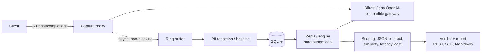

# Bifrost Replay Lab

> **Can I switch from `gpt-4o` to a cheaper model without breaking production?**
> Replay Lab answers that with your own traffic: it captures real gateway requests, replays them against candidate models under a hard budget cap, and returns a `SAFE_TO_SWITCH` / `SWITCH_WITH_CAUTION` / `DO_NOT_SWITCH` verdict with projected monthly savings.

Built for the Bifrost track: Bifrost has routing, caching, governance and logging plugins, but nothing that turns recorded traffic into a model-switch decision (see [DESIGN.md](DESIGN.md)). Replay Lab is a **native Bifrost plugin**: it implements `schemas.LLMPlugin` and `schemas.HTTPTransportPlugin` from Bifrost core v1.15.1 and is tested against the real Bifrost engine.

## How it works



1. **Capture.** The proxy forwards each request and records it off the hot path. If the buffer is full the capture is dropped and counted; the request is never slowed. Sampling rate and per-key opt-in/opt-out are configurable at runtime.
2. **Protect.** Emails, phone numbers, card numbers and API tokens are redacted before anything reaches disk. Hash-only mode stores SHA-256 digests instead. Captures expire after `retention_days`.
3. **Replay.** Captured prompts are replayed with their original parameters (`max_tokens`, `response_format`, ...) at temperature 0. Before every call the engine checks that the projected cost still fits the budget, and stops with partial results if it doesn't.
4. **Score and decide.** Each candidate is scored on JSON-contract preservation, lexical similarity, latency (p50/p95), error rate and cost. Thresholds live in one place ([recommender.go](plugins/replaylab/recommender.go)). Savings are projected from the traffic rate actually observed.

## Quickstart (no API keys needed)

Requires Go 1.27+.

```bash
go run ./demo/bifrost_embedded   # inside the real Bifrost core, as a plugin
go run ./demo/run_experiment     # as a sidecar proxy, no Bifrost needed
go run ./demo/run_experiment -judge   # same, with the mock LLM judge scoring each replay
```

`bifrost_embedded` boots Bifrost with Replay Lab registered in `LLMPlugins`, sends 120 requests through Bifrost to a mock provider, and replays the captures. `run_experiment` starts a mock provider and Replay Lab in-process. It sends 200 `gpt-4o` requests through the capture proxy (a quarter of them containing synthetic PII), then replays 50 against three candidates. Output from a real run:

| Candidate | Quality | JSON valid | p50 / p95 latency | Cost savings | Verdict |
| :--- | :--- | :--- | :--- | :--- | :--- |
| `gpt-4o-mini` | 94.7 | 100% of 12 | 23ms / 29ms (-43%) | 94.1% | **SAFE TO SWITCH** |
| `claude-3-haiku` | 71.9 | 100% of 12 | 16ms / 19ms (-60%) | 91.6% | *SWITCH WITH CAUTION* |
| `meta-llama-3.1-8b` | 34.9 | 50% of 12 | 11ms / 14ms (-73%) | 99.6% | DO NOT SWITCH |

The mock provider is deterministic and gives each model tier distinct behaviour (rewording, truncation, broken JSON, occasional 503s); see [internal/mockprovider](internal/mockprovider/mockprovider.go). Flags: `-requests`, `-sample`, `-budget`, `-candidates`, `-latency`.

### In a real bifrost-http gateway (Docker, any OS)

```bash
docker compose -f loadable/compose.yml up --build    # or: make gateway-demo
```

This runs the bifrost-http release that users deploy (v1.6.11), with Replay Lab loaded as a plugin from its config and the mock provider as its upstream, still with no keys. A seed job sends traffic through the gateway and starts an experiment whose replays also go through the gateway. Then open `http://localhost:8086/replaylab/experiments`. It works on Windows through Docker Desktop. See [loadable/README.md](loadable/README.md#try-it-in-one-command).

## Deployment modes

Replay Lab has one core (`plugins/replaylab`) and three ways to run it. Only the wiring differs.

| Mode | How it runs | Use it when | Platforms |
| :--- | :--- | :--- | :--- |
| **SDK plugin** | Registered in `LLMPlugins` of a Go program that embeds Bifrost ([below](#run-inside-bifrost)) | Your application embeds Bifrost through the Go SDK | Any, including Windows; Bifrost core v1.15.1 |
| **bifrost-http plugin** | A shared object that the bifrost-http gateway loads from one `plugins` entry in its config ([loadable/README.md](loadable/README.md)) | You run the bifrost-http gateway and want capture without changing applications or adding a hop | Linux or macOS, built for one gateway release (now v1.6.11), in a dynamically linked gateway |
| **Sidecar** | A capturing proxy in front of any OpenAI-compatible gateway (`cmd/replaylab`, [below](#run-as-a-sidecar)) | You can't load plugins: Windows hosts, the official static bifrost-http image, another gateway, or a gateway version the plugin isn't built for | Any |

**Shared-object plugins need Linux or macOS.** Go can't load them on Windows. On Windows, build and run the bifrost-http plugin in containers (the gateway demo above, or `make loadable` through Docker Desktop or WSL), or use the sidecar, which runs natively (`run.bat`).

## Run inside Bifrost

Register the plugin with the Bifrost Go SDK:

```go
lab, err := replaylab.NewPlugin(replaylab.DefaultConfig())
client, err := bifrost.Init(ctx, schemas.BifrostConfig{
    Account:    account,
    LLMPlugins: []schemas.LLMPlugin{lab},
})
```

| Hook | What Replay Lab does |
| :--- | :--- |
| `PreLLMHook` | Stashes the chat request (messages, params, provider, model, virtual key). No I/O. |
| `PostLLMHook` | Pairs the response or provider error with the request and enqueues it for the background writer. Never changes the response. |
| `HTTPTransportPreHook` | Serves `/replaylab/*` from the gateway, and copies `X-Replaylab-Tag`, `X-Replaylab-Tenant` and `X-Replaylab-Replay` onto the request context. |
| other hooks | No-ops |

Replays carry `X-Replaylab-Replay`, so the plugin never captures its own replay traffic. Set `GatewayURL` to your bifrost-http address and name candidates as `provider/model` (for example `anthropic/claude-3-5-haiku`). Set `APIListenAddr` (for example `:8086`) to serve the API on its own port with live SSE progress, since transport hooks buffer responses. Your `go.mod` needs the same `mcp-go` `replace` line as Bifrost core; see this repo's [go.mod](go.mod).

### Load into a bifrost-http gateway

To add Replay Lab to a running bifrost-http gateway without writing Go, build the **loadable plugin** (a shared object) and add one entry to the gateway's `plugins` config. It targets bifrost-http v1.6.11, runs on Linux or macOS, and needs a dynamically linked gateway, which the official image isn't. [loadable/README.md](loadable/README.md) has the build, an example entry with every config key, the loader errors and what they mean, and the upgrade path to a newer gateway release: change the transports version in `loadable/go.mod`, rebuild, rerun the smoke test.

## Run as a sidecar

```bash
docker compose up --build          # mock provider on :8081, Replay Lab on :8085
go run ./demo/generate_traffic     # send 200 requests through the proxy
```

Without Docker (Windows): `run.bat mock` in one terminal, `run.bat` in another, then `run.bat traffic`.

Point any OpenAI SDK at `http://localhost:8085/v1` to capture its traffic. To replay through a real gateway, set `GATEWAY_URL` (and `REPLAY_AUTH_TOKEN` if replays need a key other than the captured virtual key).

## API

Full reference with request/response shapes: [docs/replaylab.md](docs/replaylab.md). Postman collection: [demo/replaylab.postman_collection.json](demo/replaylab.postman_collection.json).

| Method | Path | Purpose |
| :--- | :--- | :--- |
| `POST` | `/v1/chat/completions` | Capturing proxy (OpenAI-compatible) |
| `GET` | `/replaylab/health` | Status, stored/dropped captures, active experiments |
| `GET` | `/replaylab/metrics` | Prometheus metrics |
| `GET` / `PUT` | `/replaylab/config` | Read / partially update runtime config |
| `GET` | `/replaylab/models` | Price book used for cost estimates |
| `GET` | `/replaylab/captures`, `/replaylab/captures/{id}` | Browse captures |
| `POST` | `/replaylab/experiments` | Start an experiment (`"dry_run": true` to estimate cost) |
| `GET` | `/replaylab/experiments`, `/replaylab/experiments/{id}` | List / poll experiments |
| `POST` | `/replaylab/experiments/{id}/cancel` | Stop a running experiment |
| `GET` | `/replaylab/experiments/{id}/events` | Live progress (SSE); always ends with `"final": true` |
| `GET` | `/replaylab/experiments/{id}/report?format=markdown` | Shareable report |

## Performance

`go test -bench=. -benchmem ./tests ./plugins/replaylab` on an Intel i5-12450H:

| Benchmark | Result |
| :--- | :--- |
| Capture hot path (enqueue only) | ~2.4 µs/op, 946 B/op |
| Enqueue with SQLite writers running on the same machine | ~57 µs/op (~17k captures/s sustained) |
| Proxy: relay one SSE chunk, capture off | ~6 ns/chunk |
| Proxy: relay one SSE chunk, capture on (client-write path) | ~35 ns/chunk |
| Proxy: parse one SSE chunk (capture goroutine, off the client-write path) | ~1.2 µs/chunk |

## Testing

```bash
go vet ./...
go test ./tests/...
```

The tests cover redaction, scoring, recommendations, budget-cap enforcement, upstream failures, proxy capture, SSE termination, config updates and pricing lookup. [tests/bifrost_plugin_test.go](tests/bifrost_plugin_test.go) runs the real Bifrost core with the plugin registered: it checks capture and redaction, provider errors, replay skipping, and the API served via the transport hook, then runs a full capture-to-verdict experiment. [tests/stream_capture_test.go](tests/stream_capture_test.go) and [tests/proxy_stream_test.go](tests/proxy_stream_test.go) cover streamed capture through Bifrost and through the proxy: reassembly, usage and estimated usage, mid-stream errors, abandonment, truncation, the `streamed` filter and replaying streamed captures to a verdict. CI ([.github/workflows/ci.yml](.github/workflows/ci.yml)) also runs them under the race detector. On Linux, CI also builds the loadable plugin and runs the gateway smoke test ([loadable/smoketest](loadable/smoketest/main.go)), which loads it into the real bifrost-http release and checks capture, redaction, verdicts, replay skipping, restart survival and config errors over HTTP only. Locally: `make loadable-smoke` (needs Docker).

## Repository layout

| Path | What's there |
| :--- | :--- |
| `plugins/replaylab/` | The core, shared by every deployment mode: capture, redaction, storage, replay, scoring, judge, recommendations and the API |
| `cmd/replaylab/`, `cmd/mockprovider/` | The sidecar proxy, and the deterministic OpenAI-compatible mock used by the demos and tests |
| `internal/mockprovider/` | The mock's model tiers and behaviours |
| `loadable/` | The bifrost-http plugin: entry point, pinned module, container build, gateway smoke test and the one-command demo ([README](loadable/README.md)) |
| `demo/` | Runnable demos (`bifrost_embedded`, `run_experiment`, `generate_traffic`), sample prompts and a Postman collection |
| `tests/` | Unit tests, real-Bifrost plugin tests and end-to-end experiment tests |
| `docs/` | The API reference ([replaylab.md](docs/replaylab.md)) and the architecture decision record for the gateway plugin ([adr/](docs/adr/)) |
| `DESIGN.md` | Why Replay Lab exists and how it's built |
| `docker-compose.yml`, `Dockerfile.*` | The sidecar demo: the mock provider and Replay Lab in containers |
| `Makefile`, `run.bat` | Shortcuts for building, testing and the demos (`run.bat` on Windows) |

## Limitations

- **Without a judge, quality is a similarity score, not a semantic judgement.** A candidate that answers correctly in different words scores lower than one that paraphrases closely. Set `judge` on an experiment to have a judge model compare each replay with the baseline in both orders (see [docs/replaylab.md](docs/replaylab.md#judge)); judge thresholds are not yet calibrated against human labels.
- **Only chat completions are captured**, streamed or not, on both paths. Other request types pass through untouched. For streams only the assistant text is kept; tool-call and reasoning deltas are not.
- **Streamed captures through the proxy have estimated token counts** unless the client asks for usage (`stream_options.include_usage`); the proxy doesn't add it. These captures have `"usage_estimated": true`.
- **The SDK plugin is tested against Bifrost core v1.15.1. The loadable plugin targets bifrost-http v1.6.11 (core v1.7.10) only.** A shared object loads only into the gateway release it was built for, and the official bifrost-http image is static, so it can't load plugins at all. See [loadable/README.md](loadable/README.md).
- Prices in the cost book are list prices and should be checked before quoting real savings.
