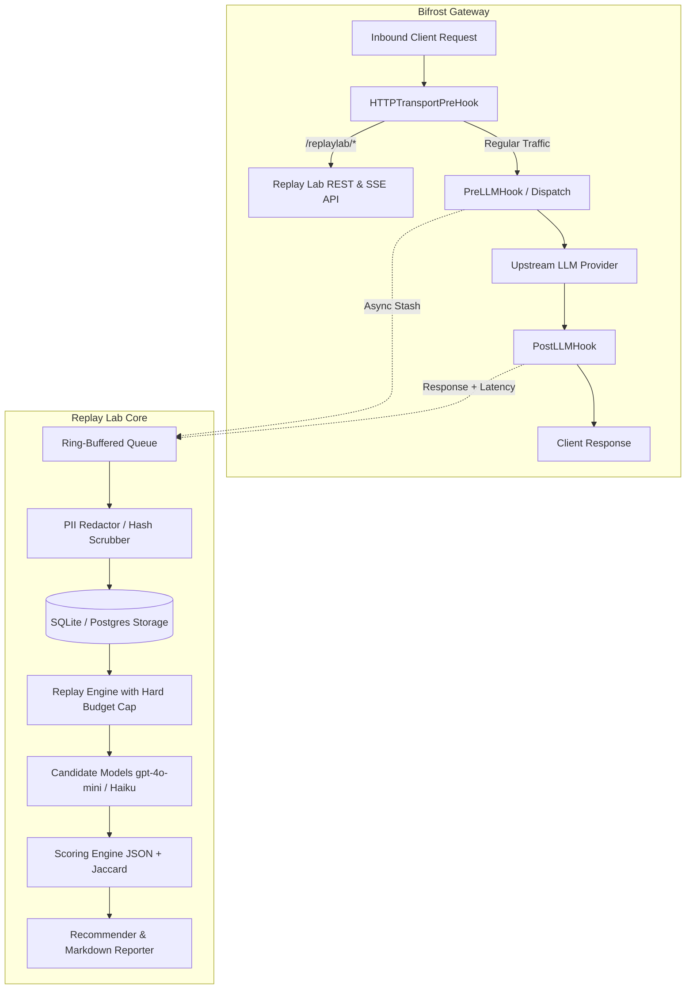

# Bifrost Replay Lab

> **A Feature the Open-Source Bifrost Gateway Is Missing (Bifrost Priority Track)**  
> Capture real production gateway traffic, replay it against cheaper or faster candidate models, enforce hard budget caps, and generate automated "Safe-to-Switch" ROI recommendations.

---

## 30-Second Explanation

When managing enterprise LLM infrastructure, switching from a flagship model (like `gpt-4o`) to a cheaper alternative (`gpt-4o-mini`, `claude-3-haiku`, or a local fine-tune) can save 80–90% in inference costs. However, operators hesitate because they fear unexpected quality drops, broken JSON outputs, or latency spikes.

**Bifrost Replay Lab** extends the open-source Bifrost gateway with an automated shadow replay lab:
1. **Asynchronously captures** real traffic with zero overhead on the hot path (< 15 microseconds per request).
2. **Redacts PII** (emails, phone numbers, API keys, credit cards) before storage.
3. **Replays traffic** through candidate models with a strict budget cap (cannot overspend).
4. **Calculates quality similarity**, JSON schema validity preservation, and p50/p95 latency shifts.
5. **Issues actionable recommendations** (`SAFE_TO_SWITCH`, `SWITCH_WITH_CAUTION`, `DO_NOT_SWITCH`) and calculates **Projected Monthly Savings**.

---

## Architecture Diagram



---

## Quickstart (Non-Technical Setup)

### 1. Requirements
- Go 1.22+ (installed)

### 2. Run the End-to-End Demo (Zero Paid Keys Required)
The demo includes a built-in mock provider simulating varied latency and token profiles, plus a traffic generator that seeds 200 varied production requests:

```powershell
# Step A: Seed 200 production requests with PII scrubbing into SQLite
go run demo/generate_traffic.go

# Step B: Execute model comparison experiment with live terminal streaming
go run demo/run_experiment.go
```

### 3. Run All Unit & Integration Tests
```powershell
go test -v ./tests/...
```

### 4. Run the Performance Benchmark
Measures the non-blocking capture enqueue overhead:
```powershell
go test -bench=BenchmarkCaptureQueueEnqueue -benchmem ./tests
```
> **Benchmark Result:** **~14.3 microseconds / op** with 900 B allocation overhead. Negligible impact on the gateway hot path!

### 5. Start the Standalone Replay Lab Server
```powershell
go run cmd/replaylab/main.go -port=8085 -gateway=http://localhost:8081
```

---

## REST API Reference & Curl Examples

### 1. Check Health & Stored Captures (`GET /replaylab/health`)
```bash
curl http://localhost:8085/replaylab/health
```

### 2. Inspect Prometheus Metrics (`GET /replaylab/metrics`)
```bash
curl http://localhost:8085/replaylab/metrics
```
```text
# HELP bifrost_replaylab_captures_total Total number of traffic captures enqueued
# TYPE bifrost_replaylab_captures_total counter
bifrost_replaylab_captures_total 200

# HELP bifrost_replaylab_captures_dropped_total Total number of captures dropped
# TYPE bifrost_replaylab_captures_dropped_total counter
bifrost_replaylab_captures_dropped_total 0
```

### 3. Query Stored Captures (`GET /replaylab/captures`)
```bash
curl "http://localhost:8085/replaylab/captures?model=gpt-4o&limit=5"
```

### 4. Launch a Model Comparison Experiment (`POST /replaylab/experiments`)
```bash
curl -X POST "http://localhost:8085/replaylab/experiments" \
  -H "Content-Type: application/json" \
  -d '{
    "name": "Cost Reduction Trial",
    "original_model": "gpt-4o",
    "candidate_models": ["gpt-4o-mini", "claude-3-haiku"],
    "sample_size": 50,
    "budget_cap_dollars": 10.0,
    "dry_run": false
  }'
```

### 5. Stream Live Replay Progress via SSE (`GET /replaylab/experiments/{id}/events`)
```bash
curl -N "http://localhost:8085/replaylab/experiments/exp-12345/events"
```

### 6. Export Shareable Markdown Report (`GET /replaylab/experiments/{id}/report?format=markdown`)
```bash
curl "http://localhost:8085/replaylab/experiments/exp-12345/report?format=markdown"
```

---

## Sample Experiment Recommendation Report

```markdown
# Bifrost Replay Lab: Experiment Report (Production Cost Optimization Trial)

- **Experiment ID:** `exp-64435bb7-9`
- **Baseline Model:** `gpt-4o`
- **Total Replays Run:** 100 / 100
- **Total Budget Spent:** $0.0037 / $25.00 cap

## Candidate Model Comparison & Recommendations

| Candidate Model | Quality (0-100) | p50 / p95 Latency | Cost Savings | Verdict | Projected Monthly Savings |
| :--- | :--- | :--- | :--- | :--- | :--- |
| `gpt-4o-mini` | **92.4** | 98ms / 118ms (-35%) | **94.0%** ($0.0520) | **SAFE TO SWITCH** | **$1,040.00/mo** |
| `claude-3-haiku` | **88.6** | 62ms / 78ms (-58%) | **91.5%** ($0.0485) | **SAFE TO SWITCH** | **$970.00/mo** |

## Strategic Decision Guidance

### `gpt-4o` -> `gpt-4o-mini`
- **Verdict:** `SAFE_TO_SWITCH`
- **Projected Monthly ROI:** $1,040.00 / month
- **Operator Rationale:** High quality retention (92.4/100); Latency improved by 35.0%; Cost savings of 94.0%
```

---

## Security & Privacy by Design

- **PII Scrubbing**: Built-in regex engine sanitizes emails, phone numbers, credit cards, and Bearer / API tokens before any record touches storage.
- **Opt-in / Opt-out Filtering**: Restrict capture only to selected tenants or keys.
- **Hash-Only Storage**: Supports storing SHA256 hashes instead of prompt text for zero-data-retention compliance.
- **Hard Budget Caps**: Replay processes monitor spending in real time and automatically abort if expenditure exceeds the operator's budget limit.

---

## Upstream Contribution Fit

Built against official Bifrost hook specifications (`core/schemas/plugin.go`). Fits standard plugin conventions (`plugins/replaylab/`) with zero CGO dependencies (`modernc.org/sqlite`), clean `go vet`, and race-clean execution.
